# 🎓 Sistem Informasi Sekolah & Portal Akademik — Steins Gate High School

Proyek Ujian Tengah Semester (UTS) Pemrograman Web 1 yang terdiri atas **Aplikasi Web Portal Sekolah & Akademik berbasis Role-Based Access Control (`Project1-Web`)** dan **Layanan Web RESTful API (`Project2-api`)** yang terintegrasi dalam satu basis data relasional (`steins_gate_db`).

---

## 👤 Identitas Mahasiswa

| Atribut | Keterangan |
| :--- | :--- |
| **Nama Lengkap** | Insanul Firas |
| **NIM** | `24552011147` |
| **Kelas** | `TIF RP 24 E CNS` |
| **Mata Kuliah** | Pemrograman Web 1 (UTS) |
| **Direktori Arsip** | `UTS_WEB_1_24552011147_Insanul_Firas_TIF_RP_24_E_CNS` |

---

## 🌐 Tautan Akses Live Production & Akun Pengujian

Aplikasi dan layanan REST API telah di-*deploy* secara langsung pada server *cloud hosting* InfinityFree sehingga dapat diakses dan diuji secara *online* tanpa perlu instalasi lokal.

### 🔗 URL Endpoint Utama
* **Aplikasi Web Utama (Beranda):** http://steinsgate.infinityfreeapp.com/index.php
* **Halaman Login:** http://steinsgate.infinityfreeapp.com/login.php
* **Halaman Registrasi Siswa:** http://steinsgate.infinityfreeapp.com/register.php
* **Endpoint REST API Informasi:** http://steinsgate.infinityfreeapp.com/Project2-api/informasi.php

### 🔐 Kredensial Akun Pengujian (Multi-Role)
Gunakan akun berikut pada halaman login untuk menguji hak akses masing-masing peran (*Admin*, *Guru*, dan *Siswa*):

| Peran (*Role*) | Keterangan | Username / Email | Password | Akses Dashboard Utama |
| :--- | :--- | :--- | :--- | :--- |
| **Administrator** | Pengelola Sistem & Konten | `firas.test@example.com` | `Firas12345` | `/dashboard/index.php` |
| **Guru** | Pengampu Mata Pelajaran **Biologi** | `eriyu@gmail.com` | `erirantaudi` | `/guru/index.php` |
| **Siswa** | Peserta Didik Aktif | `insanul@gmail.com` | `12345678` | `/siswa/index.php` |

---

## 🏛️ Arsitektur & Struktur Direktori Proyek

Proyek ini diorganisasikan secara modular menjadi dua sub-proyek utama dan dokumentasi bukti pengujian (*screenshots*):

```text
UTS_WEB_1_24552011147_Insanul_Firas_TIF_RP_24_E_CNS/
├── Project1-Web/                        # Aplikasi Web Utama (Multi-Role Portal Sekolah)
│   ├── assets/
│   │   ├── css/
│   │   │   ├── dashboard-pages.css      # Styling khusus komponen & tabel halaman dashboard
│   │   │   ├── modern.css               # Utilitas UI modern, kartu, & responsivitas
│   │   │   └── style.css                # Stylesheet utama halaman publik & otentikasi
│   │   ├── images/
│   │   │   ├── logo.png                 # Logo institusi sekolah
│   │   │   └── sekolah.jpg              # Banner utama halaman beranda
│   │   ├── js/
│   │   │   ├── main.js                  # Interaktivitas UI, navigasi, & modal
│   │   │   └── validation.js            # Validasi formulir sisi klien (client-side)
│   │   └── uploads/                     # Direktori penyimpanan berkas unggahan (dilindungi .htaccess)
│   │       ├── .htaccess                # Pembatasan akses eksekusi skrip di folder upload
│   │       ├── galeri/                  # Penyimpanan foto galeri kegiatan sekolah
│   │       ├── jawaban/                 # Penyimpanan dokumen PDF jawaban tugas siswa
│   │       ├── profil/                  # Penyimpanan foto profil pengguna (Admin/Guru/Siswa)
│   │       └── tugas/                   # Penyimpanan dokumen PDF soal/materi tugas dari guru
│   ├── config/
│   │   ├── app.php                      # Konfigurasi global aplikasi, base URL, & konstanta sesi
│   │   └── database.php                 # Koneksi database MySQL menggunakan PHP Data Objects (PDO)
│   ├── dashboard/                       # Modul Panel Kontrol Administrator
│   │   ├── index.php                    # Ringkasan statistik & navigasi utama Admin
│   │   ├── siswa.php                    # Manajemen data akun & profil siswa (CRUD)
│   │   ├── guru.php                     # Manajemen data akun, NIP, & mapel guru (CRUD)
│   │   ├── jadwal.php                   # Pengaturan jadwal pelajaran kelas & guru (CRUD)
│   │   ├── informasi.php                # Manajemen artikel berita & informasi sekolah (CRUD)
│   │   ├── pengumuman.php               # Manajemen papan pengumuman sekolah (CRUD)
│   │   ├── kegiatan.php                 # Manajemen agenda & kegiatan sekolah (CRUD)
│   │   ├── galeri.php                   # Manajemen unggah & hapus dokumentasi foto galeri
│   │   ├── feedback.php                 # Moderasi kotak masuk kritik, saran, & pesan publik
│   │   └── profil.php                   # Pengaturan profil & kata sandi akun Administrator
│   ├── database/
│   │   └── steins_gate_db.sql           # Skema SQL lengkap beserta data awal (seed data)
│   ├── guru/                            # Modul Panel Akademik Guru
│   │   ├── index.php                    # Beranda dashboard guru & ringkasan kelas ampu
│   │   ├── absensi.php                  # Pencatatan & rekapitulasi kehadiran siswa per pertemuan
│   │   ├── tugas.php                    # Pembuatan tugas & unggah lampiran soal PDF
│   │   ├── jawaban.php                  # Pemeriksaan berkas jawaban siswa & pemberian nilai
│   │   └── profil.php                   # Pengaturan profil & kata sandi akun Guru
│   ├── siswa/                           # Modul Panel Akademik Siswa
│   │   ├── index.php                    # Beranda dashboard siswa, jadwal, & ringkasan akademik
│   │   ├── absensi.php                  # Riwayat & rekap status kehadiran siswa
│   │   └── tugas.php                    # Daftar tugas aktif, unduh soal, & unggah jawaban PDF
│   ├── includes/                        # Komponen Layout & Helper Reusable
│   │   ├── admin_crud_helpers.php       # Fungsi pembantu operasi CRUD & sanitasi input Admin
│   │   ├── akademik_helpers.php         # Fungsi pembantu logika jadwal, tugas, & absensi
│   │   ├── guru_helpers.php             # Fungsi pembantu validasi hak akses & kelas guru
│   │   ├── functions.php                # Fungsi utilitas umum (flash message, upload file, format)
│   │   ├── header.php                   # Komponen header & navbar halaman publik
│   │   ├── footer.php                   # Komponen footer halaman publik
│   │   ├── dashboard_page_start.php     # Kerangka pembuka sidebar & topbar seluruh dashboard
│   │   └── dashboard_page_end.php       # Kerangka penutup halaman & pemuatan skrip dashboard
│   ├── index.php                        # Halaman Beranda Publik (Profil, Berita, Galeri, Kontak)
│   ├── detail.php                       # Halaman baca detail artikel informasi/berita
│   ├── siswa.php                        # Direktori publik daftar siswa aktif
│   ├── history.php                      # Halaman sejarah & profil lengkap sekolah
│   ├── login.php                        # Halaman otentikasi pengguna multi-role
│   ├── register.php                     # Halaman pendaftaran mandiri calon siswa baru
│   ├── logout.php                       # Penghancuran sesi (session destroy) & redirect
│   ├── download.php                     # Handler aman untuk mengunduh berkas tugas/jawaban PDF
│   ├── seed_admin.php                   # Utilitas inisialisasi akun admin awal
│   └── PANDUAN-CRUD-KONTEN-ADMIN.txt    # Catatan panduan pengelolaan konten bagi admin
│
├── Project2-api/                        # Layanan RESTful Web API
│   └── informasi.php                    # Endpoint CRUD JSON untuk entitas informasi sekolah
│
├── screenshots/                         # Dokumentasi Bukti Pengujian Aplikasi & API
│   ├── Postman/
│   │   ├── api-1-get-all.png            # Pengujian GET seluruh data informasi
│   │   ├── api-2-get-id.png             # Pengujian GET detail informasi berdasarkan ID
│   │   ├── api-3-post.png               # Pengujian POST penambahan data informasi baru
│   │   ├── api-4-put.png                # Pengujian PUT pembaruan data informasi
│   │   └── api-5-delete.png             # Pengujian DELETE penghapusan data informasi
│   └── Web/
│       ├── web-1-home.png               # Tampilan halaman utama publik
│       ├── web-2-detail-informasi1.png  # Tampilan detail informasi bagian atas
│       ├── web-2-detail-informasi2.png  # Tampilan detail informasi bagian bawah
│       ├── web-3-login.png              # Tampilan antarmuka halaman login
│       ├── web-4-register.png           # Tampilan antarmuka halaman registrasi siswa
│       └── web-5-dashboard.png          # Tampilan panel kontrol dashboard terautentikasi
│
└── README.md                            # Dokumentasi utama proyek
```

---

## ✨ Fitur Utama Sistem (`Project1-Web`)

### 1. Portal Informasi Publik
* **Beranda Dinamis (`index.php`):** Menampilkan profil sekolah, statistik ringkas, sorotan informasi/berita terbaru (`detail.php`), papan pengumuman, agenda kegiatan, galeri dokumentasi foto, serta formulir umpan balik (*feedback*) pengunjung.
* **Direktori Akademik & Sejarah:** Halaman khusus untuk melihat daftar direktori siswa (`siswa.php`) dan sejarah institusi (`history.php`).
* **Sistem Otentikasi Terpadu (`login.php` & `register.php`):** Mendukung registrasi mandiri untuk siswa baru serta pengarahan otomatis (*auto-redirect*) pasca-login sesuai peran pengguna (`admin` $\rightarrow$ `/dashboard/`, `guru` $\rightarrow$ `/guru/`, `siswa` $\rightarrow$ `/siswa/`).

### 2. Panel Kontrol Administrator (`/dashboard/`)
* **Manajemen Civitas Akademika:** Pengelolaan penuh (Tambah, Lihat, Ubah, Hapus) untuk data akun **Siswa** (`siswa.php`) dan **Guru** beserta mata pelajaran yang diampu (`guru.php`).
* **Manajemen Jadwal Pelajaran (`jadwal.php`):** Pengaturan hari, jam pelajaran, mata pelajaran, kelas, dan guru pengampu.
* **Manajemen Konten Publikasi:** Pengelolaan berita/informasi (`informasi.php`), pengumuman resmi (`pengumuman.php`), agenda kegiatan (`kegiatan.php`), serta unggah foto dokumentasi ke galeri (`galeri.php`).
* **Moderasi Feedback (`feedback.php`):** Peninjauan pesan, pertanyaan, dan masukan yang dikirimkan pengunjung melalui halaman beranda.

### 3. Panel Akademik Guru (`/guru/`)
* **Manajemen Absensi Siswa (`absensi.php`):** Pencatatan status kehadiran siswa (*Hadir*, *Izin*, *Sakit*, *Alpa*) berdasarkan mata pelajaran dan jadwal kelas yang diampu.
* **Manajemen Tugas & Materi (`tugas.php`):** Pembuatan penugasan baru dengan tenggat waktu (*deadline*) serta unggah lampiran berkas soal dalam format PDF.
* **Penilaian Jawaban Siswa (`jawaban.php`):** Pengunduhan berkas jawaban PDF yang dikumpulkan siswa melalui handler aman (`download.php`) serta penginputan nilai dan catatan evaluasi.

### 4. Panel Akademik Siswa (`/siswa/`)
* **Pantauan Jadwal & Kehadiran (`index.php` & `absensi.php`):** Melihat jadwal pelajaran aktif dan rekapitulasi riwayat kehadiran pribadi secara *real-time*.
* **Pengumpulan Tugas Online (`tugas.php`):** Mengunduh soal tugas PDF dari guru dan mengunggah berkas jawaban PDF langsung ke sistem serta memantau status penilaian.

---

## 🔌 Dokumentasi RESTful API (`Project2-api`)

Layanan API menyediakan antarmuka pertukaran data berformat **JSON** untuk mengelola entitas `informasi` pada basis data yang sama dengan aplikasi web utama.

* **Base Endpoint URL:**
  ```text
  http://steinsgate.infinityfreeapp.com/Project2-api/informasi.php
  ```
* **Headers Standar:**
  ```http
  Content-Type: application/json
  Accept: application/json
  ```

### Daftar Operasi Endpoint

| Metode HTTP | Endpoint | Parameter / Body Request | Deskripsi Operasi |
| :--- | :--- | :--- | :--- |
| **`GET`** | `/informasi.php` | *Tidak ada* | Mengambil seluruh daftar artikel informasi sekolah yang tersimpan (diurutkan dari terbaru). |
| **`GET`** | `/informasi.php?id={id}` | Query param `id` (Integer) | Mengambil satu data detail informasi spesifik berdasarkan ID. |
| **`POST`** | `/informasi.php` | JSON Body (`judul`, `konten`, `kategori`, dll.) | Menambahkan entri data informasi baru ke dalam database. |
| **`PUT`** | `/informasi.php?id={id}` | Query param `id` + JSON Body | Memperbarui data informasi yang sudah ada berdasarkan ID. |
| **`DELETE`** | `/informasi.php?id={id}` | Query param `id` (Integer) | Menghapus data informasi tertentu dari database berdasarkan ID. |

#### Contoh Payload Request (`POST` / `PUT`)
```json
{
  "judul": "Pengumuman Pelaksanaan Ujian Tengah Semester Genap",
  "konten": "Seluruh siswa diwajibkan mencetak kartu peserta ujian melalui portal akademik masing-masing sebelum hari Senin.",
  "penulis": "Admin Akademik"
}
```

#### Contoh Respons Sukses (`200 OK` / `201 Created`)
```json
{
  "status": "success",
  "message": "Data informasi berhasil diambil",
  "data": [
    {
      "id": 1,
      "judul": "Pengumuman Pelaksanaan Ujian Tengah Semester Genap",
      "konten": "Seluruh siswa diwajibkan mencetak kartu peserta ujian...",
      "created_at": "2026-11-20 08:30:00"
    }
  ]
}
```

---

## 📸 Dokumentasi Tangkapan Layar (*Screenshots*)

Berikut adalah hasil dokumentasi visual dari pengujian fungsionalitas **Aplikasi Web (`Project1-Web`)** dan **REST API (`Project2-api`)**:

### 🖥️ 1. Pengujian Antarmuka Aplikasi Web (`screenshots/Web/`)

#### Halaman Beranda Utama (`index.php`)
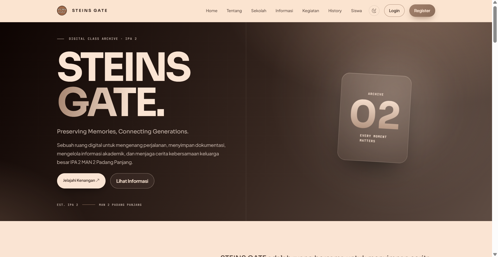

#### Halaman Detail Informasi & Berita (`detail.php`)
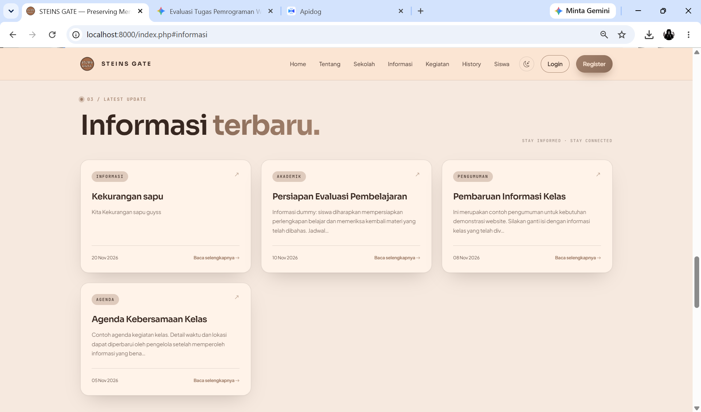

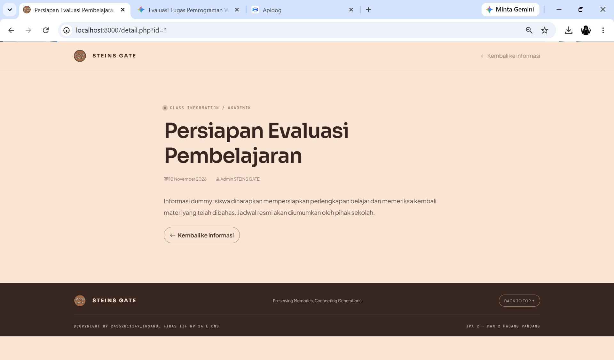

#### Halaman Otentikasi Pengguna (`login.php` & `register.php`)
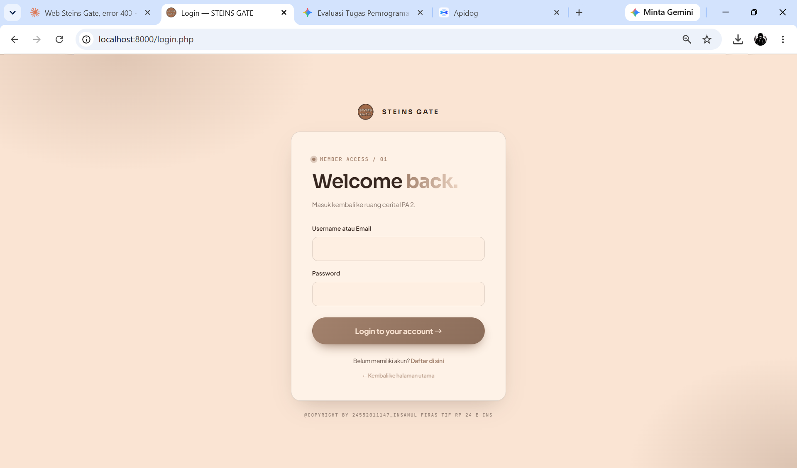

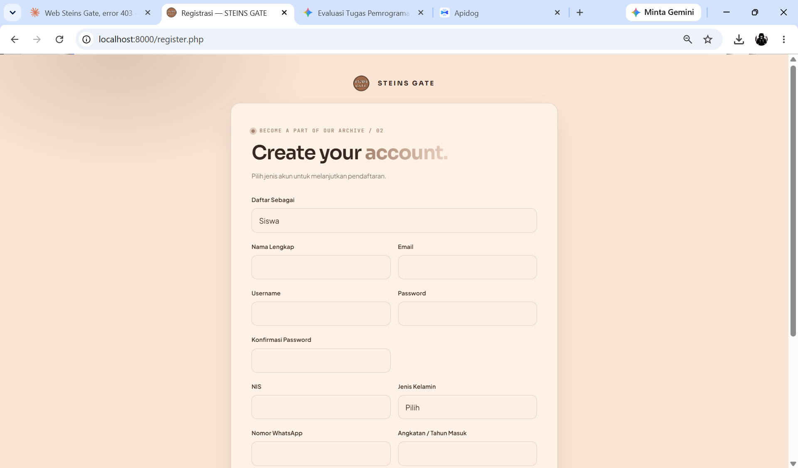

#### Panel Kontrol Dashboard Terautentikasi
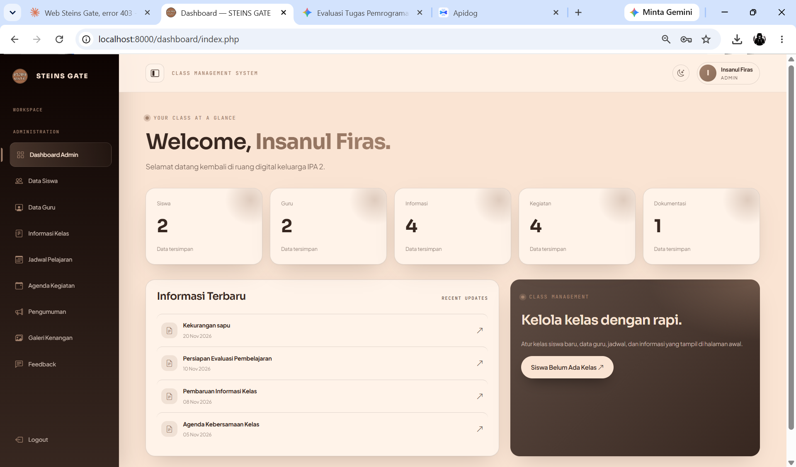

---

### 🚀 2. Pengujian Endpoint REST API via Postman (`screenshots/Postman/`)

#### 1. `GET` — Mengambil Seluruh Data Informasi
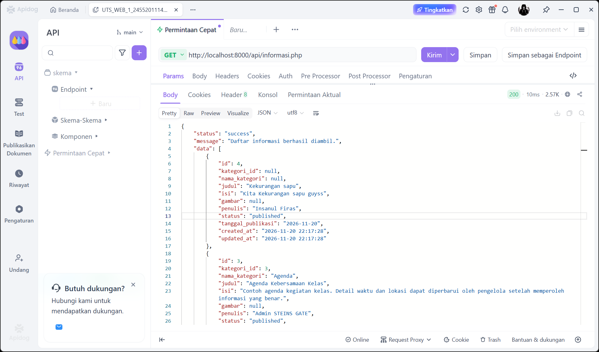

#### 2. `GET` — Mengambil Detail Data Informasi Berdasarkan ID
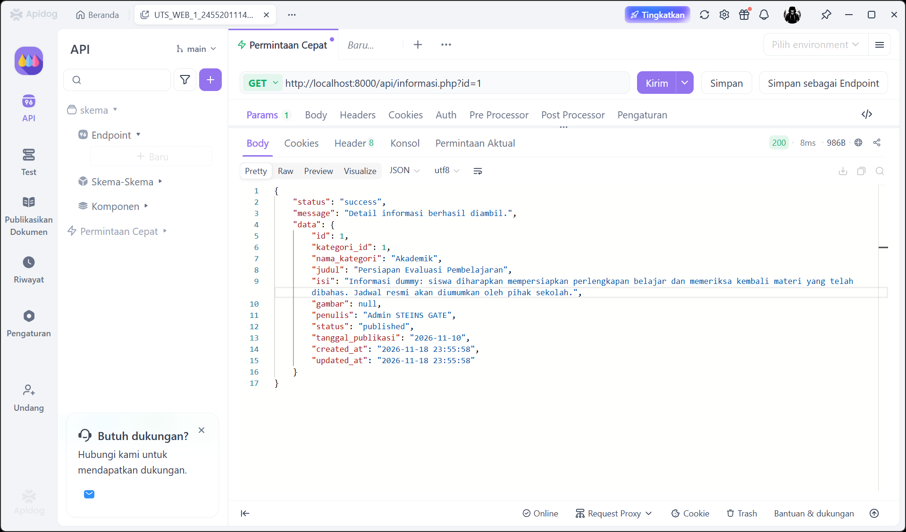

#### 3. `POST` — Menambahkan Data Informasi Baru
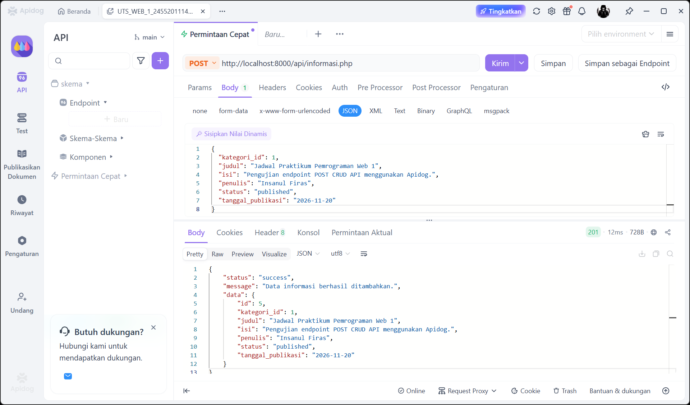

#### 4. `PUT` — Memperbarui Data Informasi
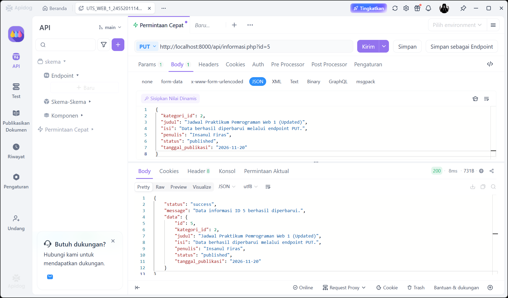

#### 5. `DELETE` — Menghapus Data Informasi
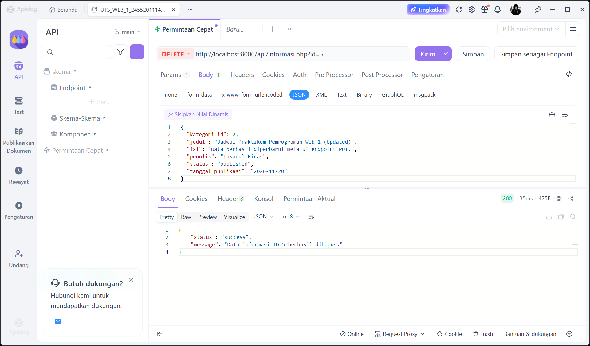

---

## 🛠️ Panduan Instalasi Lokal (XAMPP / Laragon)

Apabila ingin menjalankan proyek secara lokal di lingkungan pengembangan (*development*):

1. **Ekstrak Arsip:**
   Ekstrak folder `UTS_WEB_1_24552011147_Insanul_Firas_TIF_RP_24_E_CNS` ke dalam direktori web server lokal Anda (misalnya `C:\xampp\htdocs\`).

2. **Buat & Impor Basis Data:**
   * Jalankan layanan **Apache** dan **MySQL** pada XAMPP/Laragon.
   * Buka `http://localhost/phpmyadmin`, buat database baru bernama **`steins_gate_db`**.
   * Pilih database `steins_gate_db` $\rightarrow$ klik tab **Import** $\rightarrow$ pilih file `Project1-Web/database/steins_gate_db.sql` $\rightarrow$ klik **Go**.

3. **Konfigurasi Koneksi Database:**
   Sesuaikan file `Project1-Web/config/database.php` untuk lingkungan lokal:
   ```php
   <?php
   $host     = 'localhost';
   $dbname   = 'steins_gate_db';
   $username = 'root';
   $password = '';
   ```

4. **Akses Aplikasi:**
   * **Aplikasi Web:** `http://localhost/UTS_WEB_1_24552011147_Insanul_Firas_TIF_RP_24_E_CNS/Project1-Web/index.php`
   * **REST API:** `http://localhost/UTS_WEB_1_24552011147_Insanul_Firas_TIF_RP_24_E_CNS/Project2-api/informasi.php`

---

## 🔒 Aspek Keamanan & Praktik Terbaik yang Diterapkan

* **Prepared Statements (PDO):** Seluruh kueri SQL pada aplikasi web maupun REST API menggunakan *parameter binding* PDO untuk mencegah serangan **SQL Injection**.
* **Password Hashing:** Kata sandi pengguna disimpan menggunakan algoritma `password_hash()` (Bcrypt) dan diverifikasi dengan `password_verify()`.
* **Proteksi Direktori Unggahan (`.htaccess`):** Direktori `assets/uploads/` dan `assets/uploads/jawaban/` dilengkapi berkas `.htaccess` untuk mencegah eksekusi skrip berbahaya di dalam folder penyimpanan berkas pengguna.
* **Kontrol Akses Berbasis Peran (RBAC):** Validasi sesi dan pengecekan peran dilakukan pada setiap halaman dashboard (`/dashboard/`, `/guru/`, `/siswa/`) untuk mencegah akses lintas peran tanpa otorisasi.